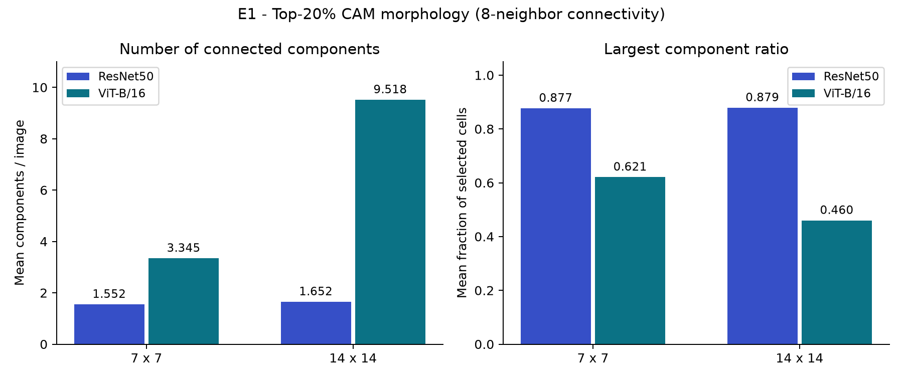
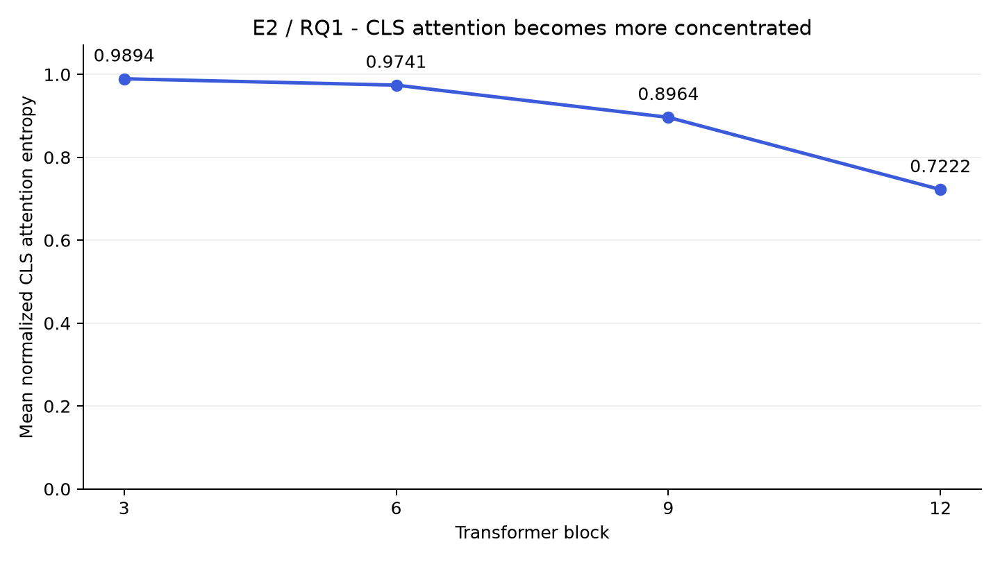
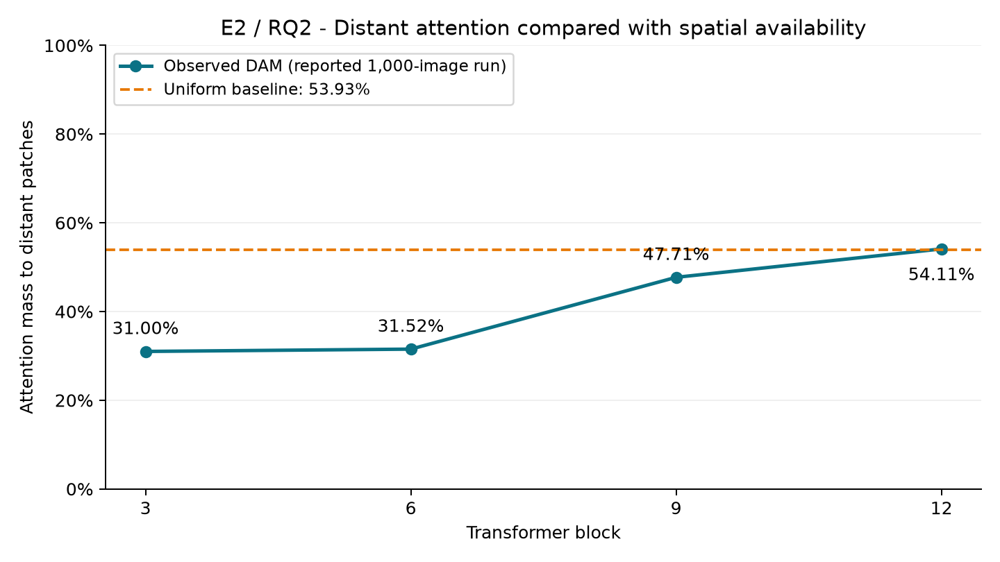
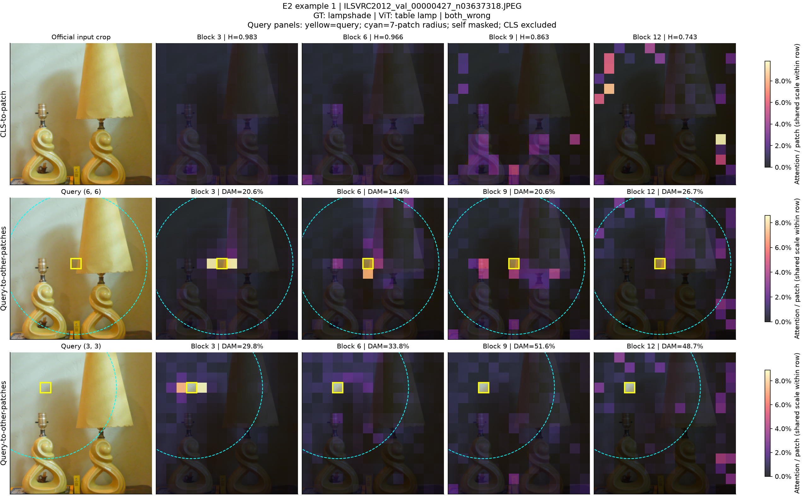

# Báo cáo Experiment 1 và Experiment 2: Grad-CAM và attention trong CNN–ViT

## 1. Thiết lập chung và nguồn kết quả

Báo cáo khảo sát hai khía cạnh: sự khác biệt giữa **Grad-CAM** của ResNet50 và ViT-B/16, và sự thay đổi của **self-attention** trong ViT-B/16 theo độ sâu. Hai thí nghiệm cung cấp các góc nhìn bổ sung; Grad-CAM và attention weights không phải cùng một đại lượng và không được diễn giải thay thế cho nhau.

| Thành phần | Thiết lập |
| --- | --- |
| CNN | ResNet50, `IMAGENET1K_V2` |
| Vision Transformer | ViT-B/16, `IMAGENET1K_V1` |
| Preprocessing | Official weights transforms của từng model; center crop 224×224 |
| Dataset | ImageNet-1K validation; shared analysis manifest gồm 10.000 ảnh, 10 ảnh/class, seed 42 |
| E1 | 10.000 ảnh; so sánh trên cùng ảnh và vùng giao của hai official crops |
| E2 | 1.000 ảnh, một ảnh/class được chọn cố định từ analysis cohort |
| Attention blocks | Block 3, 6, 9, 12; trung bình 12 attention heads |

**Nguồn số liệu:** các bảng aggregate trong báo cáo lấy từ bản tổng hợp kết quả do người thực hiện cung cấp. Các biểu đồ aggregate được vẽ lại từ những giá trị này, không phải kết quả chạy lại toàn cohort trên laptop. Chưa đối chiếu đầy đủ với exported metrics, coverage và metadata của lượt chạy Colab; báo cáo không đưa ra kết luận về statistical significance.

**Nguồn hình minh họa:** panel ảnh lamp trong phần E2 được tạo trực tiếp trên laptop từ dataset gốc và pretrained ViT-B/16 đã cache, dùng official transform và cách lấy attention của notebook 03. Đây là minh họa định tính bổ sung, không thay thế số liệu của cohort 1.000 ảnh. Các notebook và checkpoint thí nghiệm được giữ nguyên.

## 2. Experiment 1 — ResNet50 và ViT-B/16 phân bố Grad-CAM khác nhau như thế nào?

### 2.1. Mục đích

**Câu hỏi:** trên cùng một ảnh và cùng ground-truth target, ResNet50 và ViT-B/16 có khác nhau về vị trí nổi bật và hình thái phân bố Grad-CAM không?

Grad-CAM kết hợp activation maps với gradient của **ground-truth logit** để tạo class-specific attribution map. Heatmap thể hiện attribution theo phương pháp này; nó không phải segmentation mask và không trực tiếp chứng minh quan hệ nhân quả.

### 2.2. Phương pháp

- Giữ model ở `eval()` và sử dụng official preprocessing riêng của mỗi model.
- Lấy near-head Grad-CAM: `layer4[-1]` của ResNet50 và `ln_1` trước self-attention ở block cuối của ViT-B/16; bỏ CLS token khi đưa ViT activation về spatial grid.
- Đưa CAM về vùng giao của hai crops trong tọa độ ảnh gốc, rồi lấy mẫu trên cùng grid. Grid **7×7** là phân tích chính; **14×14** là sensitivity check.
- Các so sánh sử dụng cặp CAM hợp lệ của cùng `image_id`. CAM lỗi hoặc suy biến không được thay bằng giá trị metric bằng 0.

### 2.3. Metrics

| Metric | Đo điều gì? | Diễn giải |
| --- | --- | --- |
| Spearman rank correlation | Hai CAM có xếp hạng độ nổi bật của các vị trí tương tự nhau không? | Trong [−1, 1]; gần 1: cùng thứ hạng; gần 0: ít tương quan đơn điệu; gần −1: thứ hạng ngược nhau. |
| Top-20% IoU | Hai tập vị trí nổi bật nhất chồng lấp đến mức nào? | `intersection / union`, trong [0, 1]. |
| Normalized CAM Entropy | Attribution phân bố tập trung hay đồng đều? | Chuẩn hóa CAM thành phân bố không âm có tổng 1, tính `−Σ p log(p) / log(N)`. Gần 0: tập trung; gần 1: đồng đều. |
| Number of Connected Components | Top-20% CAM có bao nhiêu cụm tách biệt? | Số cụm liên thông theo **8-neighbor connectivity**, gồm chung cạnh hoặc góc. |
| Largest Component Ratio | Cụm lớn nhất chiếm bao nhiêu phần của vùng top-20%? | `số ô trong cụm lớn nhất / tổng số ô được chọn`, trong (0, 1]. |

Top-20% được triển khai bằng cách lấy `ceil(0,2 × N)` ô có CAM cao nhất: 10/49 ô trên grid 7×7 và 40/196 ô trên grid 14×14. Khi hòa điểm tại ngưỡng, dùng thứ tự hàng–cột để giữ cùng quy tắc với phân tích IoU. Tỷ lệ được chọn thực tế xấp xỉ 20,41% ở cả hai grid.

### 2.4. Kết quả: vị trí nổi bật

| Metric | Grid 7×7 | Grid 14×14 |
| --- | ---: | ---: |
| Mean Spearman | −0,0141 | −0,0089 |
| Mean Top-20% IoU | 0,1550 | 0,1414 |
| Mean entropy difference, ViT − ResNet | ≈ −0,022 | ≈ −0,113 |

Mean Spearman rất gần 0 cho thấy mức tương đồng thấp về thứ hạng spatial attribution ở mức tổng hợp. Điều này không có nghĩa mọi ảnh đều có correlation gần 0; cần per-image distribution để phân biệt các trường hợp tương quan dương và âm có thể bù trừ nhau.

Top-20% IoU khoảng 0,14–0,16 cho thấy hai model có overlap tương đối thấp giữa các vùng nổi bật nhất. Kết quả mô tả sự khác biệt giữa hai CAM, chưa cho biết CAM nào định vị đối tượng chính xác hơn.

Entropy của ViT thấp hơn ResNet trên cả hai grid trong bản tổng hợp. Chênh lệch nhỏ ở 7×7 và lớn hơn ở 14×14 cho thấy kết luận về mức độ tập trung có phụ thuộc spatial resolution. Đây là xu hướng trong thiết lập đo hiện tại, không phải một đặc tính bất biến của mọi CNN và ViT.

### 2.5. Kết quả bổ sung: hình thái các vùng nổi bật

| Grid | ResNet: Number of Components | ViT: Number of Components | ResNet: Largest Component Ratio | ViT: Largest Component Ratio |
| --- | ---: | ---: | ---: | ---: |
| 7×7 | 1,552 | 3,345 | 0,877 | 0,621 |
| 14×14 | 1,652 | 9,518 | 0,879 | 0,460 |



*Hình 1. Mean morphology metrics của top-20% CAM, vẽ từ số liệu aggregate được cung cấp. Hai model dùng cùng quy tắc chọn ô và 8-neighbor connectivity.*

ResNet có ít connected components hơn và Largest Component Ratio cao hơn ở cả hai grid. Vùng top-20% của ResNet vì vậy có xu hướng tạo một cụm lớn, liền mạch hơn. ViT có nhiều cụm tách biệt hơn; khác biệt rõ nhất trên grid 14×14.

Entropy thấp hơn và số cụm nhiều hơn **không mâu thuẫn**: entropy đo cách attribution mass phân bố, còn connected components đo tính liên thông của tập ô được chọn. Một CAM có thể dồn nhiều mass vào một số điểm mạnh nhưng các điểm này nằm rời nhau.

### 2.6. Kết luận E1

Trong thiết lập này, ResNet50 và ViT-B/16 tạo Grad-CAM khác biệt ở cả **vị trí** lẫn **hình thái**: overlap thấp và mean rank correlation gần 0; ResNet có vùng nổi bật liền mạch hơn, còn ViT có nhiều cụm nổi bật rời rạc hơn.

Cần giữ hai giới hạn khi diễn giải. Thứ nhất, native CAM của ResNet và ViT có resolution khác nhau; resampling, sparsity và cutoff ties có thể ảnh hưởng connectivity. Thứ hai, chưa có localization ground truth hoặc causal intervention để kết luận heatmap nào tốt hơn.

## 3. Experiment 2 — Attention thay đổi theo độ sâu của ViT-B/16 như thế nào?

### 3.1. Mục đích và phương pháp

- **RQ1:** CLS token phân bổ attention đến image patches như thế nào? Attention có trở nên tập trung hơn ở các block sâu không?
- **RQ2:** Một query patch phân bổ attention tới các patch gần và xa như thế nào? Phạm vi tương tác không cục bộ có thay đổi theo block không?

Trích xuất direct attention weights tại block 3/6/9/12 trên native grid **14×14**, tương ứng 196 image patches. Attention được trung bình qua 12 heads. RQ1 lấy hàng CLS-to-patch; RQ2 lấy các hàng query-patch-to-patch. Không dùng attention rollout để thay thế direct attention trong hai phân tích này.

### 3.2. RQ1 — Mức độ tập trung của CLS attention

**Metric: Normalized CLS Attention Entropy.** Lấy attention từ CLS tới 196 image patches, chuẩn hóa trên các patch destinations rồi tính entropy chia cho `log(196)`. Giá trị gần 1 tương ứng phân bố gần đồng đều; giảm entropy phản ánh mức phân hóa lớn hơn giữa các patches.

| Transformer block | Mean normalized entropy |
| --- | ---: |
| 3 | 0,9894 |
| 6 | 0,9741 |
| 9 | 0,8964 |
| 12 | 0,7222 |



*Hình 2. Entropy giảm qua các block được khảo sát. Đây là mean của cohort 1.000 ảnh theo bản tổng hợp; chưa có error bars hoặc confidence intervals.*

Block 3 và 6 có entropy gần 1: sau khi trung bình heads, CLS attention còn phân bố tương đối đồng đều. Đến block 9, entropy giảm xuống 0,8964; tại block 12 còn 0,7222, thấp hơn block 3 khoảng **0,2672**.

**Trả lời RQ1:** ở các block được khảo sát, CLS attention trở nên chọn lọc hơn theo độ sâu. Kết luận này nói về mức độ tập trung của head-averaged attention; không tự chứng minh CLS đang chú ý đúng đối tượng hoặc mọi head đều có cùng hành vi.

### 3.3. RQ2 — Distant Attention Mass

**Metric chính: Distant Attention Mass (DAM).** Tọa độ tâm patch được biểu diễn bằng chỉ số hàng–cột trên grid 14×14. Với query patch `q`, patch `k` được xem là distant khi:

```text
distance(q, k) = sqrt((row_q − row_k)^2 + (col_q − col_k)^2) ≥ 7 patch steps
```

Ngưỡng 7 patch steps tương ứng 112 pixels trên input 224×224; đây là quy ước spatial range của thí nghiệm. Loại attention dành cho CLS và chính query, rồi chuẩn hóa trên **195 patch destinations còn lại**:

```text
DAM(q) = Σ attention(q, k), với distance(q, k) ≥ 7
         -------------------------------------------------
         Σ attention(q, k), với k là image patch và k ≠ q
```

Near mass là `1 − DAM`, với các destination có khoảng cách < 7 và khác query. Nếu denominator bằng 0, DAM không xác định và không được thay bằng 0. DAM ở đây là tỷ lệ **có điều kiện trên attention tới các patch khác**, không phải tỷ lệ của toàn bộ attention row bao gồm CLS và self-attention.

**Uniform baseline:** giả sử attention phân bố đều trên 195 patch khác. Baseline của mỗi query bằng `số distant patches / 195`; tính riêng từng query để xử lý edge effects. Trung bình trên đủ 196 queries cho baseline **53,9299%**, làm tròn **53,93%**. Vì số distant destinations vốn khá lớn, DAM cao tuyệt đối chưa đủ để kết luận có ưu tiên distant patches.

DAM được tính cho toàn bộ 196 queries/ảnh, trung bình trong mỗi ảnh rồi trung bình trên 1.000 ảnh với trọng số bằng nhau. Không chọn query theo heatmap. RQ2 chỉ dùng DAM, uniform baseline và query-based visualizations; không bổ sung entropy, connected components hay IoU.

| Block | Mean DAM | Uniform baseline | DAM − uniform | Mean near mass |
| --- | ---: | ---: | ---: | ---: |
| 3 | 31,00% | 53,93% | −22,93 pp | 69,00% |
| 6 | 31,52% | 53,93% | −22,41 pp | 68,48% |
| 9 | 47,71% | 53,93% | −6,22 pp | 52,29% |
| 12 | 54,11% | 53,93% | +0,18 pp | 45,89% |



*Hình 3. DAM quan sát từ bản tổng hợp và uniform baseline tính từ hình học grid. `pp` là percentage points. Near mass và DAM có tổng 100% sau khi loại CLS và chính query.*

- **Block 3–6:** DAM khoảng 31%, thấp hơn uniform baseline hơn 22 pp. Attention tới các patch khác có xu hướng ưu tiên spatial neighbors.
- **Block 9:** DAM tăng lên 47,71%; khoảng cách tới baseline giảm còn 6,22 pp, cho thấy attention mass tới distant patches tăng lên.
- **Block 12:** DAM đạt 54,11%, gần uniform baseline 53,93%. Chênh lệch +0,18 pp chưa đủ để kết luận có một distant preference đáng kể; kết quả phù hợp với việc không còn thiên lệch mạnh về gần/xa ở mức tổng attention mass so với baseline này.

Để đối chiếu các chỉ số với spatial attention thực tế, hình dưới sử dụng một ảnh **lampshade** (`ILSVRC2012_val_00000427_n03637318.JPEG`). Cùng hai query cố định được giữ qua bốn block, không chọn lại theo heatmap.



*Hình 4. Hàng đầu là CLS-to-patch attention; hai hàng dưới là query-to-other-patches tại `(6,6)` và `(3,3)`, tọa độ zero-based. Viền vàng đánh dấu query; vòng cyan có bán kính 7 patch steps, với distant destinations nằm trên/ngoài vòng. Chính query được mask, CLS bị loại khỏi patch-query distribution. Màu biểu diễn attention probability, dùng chung color scale giữa bốn block trong mỗi hàng. `H` và DAM trên hình là giá trị của riêng ảnh/query này, không phải mean toàn cohort.*

Ở query `(3,3)`, DAM tăng từ khoảng 29,8% tại block 3 lên 51,6% tại block 9, rồi còn 48,7% tại block 12: có attention tới các patch xa nhưng không tăng đơn điệu trên mọi query. Hàng CLS cũng cho phép đối chiếu entropy với hình thái phân bố attention. Ví dụ này minh họa cách đọc metrics; xu hướng tổng hợp vẫn được xác định từ cohort 1.000 ảnh. ViT dự đoán **table lamp**, khác ground truth **lampshade**, nên attention có cấu trúc không đồng nghĩa prediction đúng.

**Trả lời RQ2:** direct self-attention thực sự phân bổ attention tới các vị trí không liền kề. Qua các block khảo sát, phân bổ chuyển từ thiên về gần ở block 3–6 sang dành tỷ lệ lớn hơn cho các patch xa ở block 9–12. Đây là quan sát từ attention weights trên dữ liệu, không chỉ suy luận từ cấu trúc all-to-all của self-attention.

### 3.4. Kết luận E2

ViT-B/16 thay đổi theo độ sâu trên hai khía cạnh khác nhau:

1. **Mức độ chọn lọc:** CLS-to-patch entropy giảm từ 0,9894 xuống 0,7222.
2. **Phạm vi không gian:** patch-to-patch DAM tăng từ 31,00% lên 54,11%; so với uniform baseline, xu hướng ưu tiên gần giảm rõ ở các block sâu.

Hai kết quả không đối lập: CLS có thể tập trung hơn trong khi các patch tokens phân bổ attention rộng hơn, vì chúng là những query khác nhau. Không suy ra causal influence, semantic correspondence hoặc robustness chỉ từ các bản đồ attention.

## 4. Tổng kết và giới hạn

**E1:** hai model có spatial attribution khác nhau; trong top-20% CAM, ResNet có xu hướng tạo vùng liền mạch hơn, còn ViT có nhiều cụm rời rạc hơn. Kết quả cần được đọc cùng grid resolution, cutoff ties và coverage.

**E2:** ở block 3–6, CLS token phân bổ attention gần đồng đều trên ảnh, còn các query patches dành khoảng 69% attention cho những patch gần. Đến block 12, CLS attention tập trung hơn vào một số vùng, trong khi attention từ query patches tới các patch xa tăng lên khoảng 54%. Tuy nhiên, mức 54% này gần bằng uniform baseline 53,93%, nên chưa cho thấy model ưu tiên patch xa hơn mức phân bổ đồng đều.

**Giới hạn:** chưa có confidence intervals hoặc kiểm định statistical significance. CAM và attention chỉ mô tả phân bố quan sát được, chưa chứng minh vùng ảnh nào thực sự quyết định prediction.
